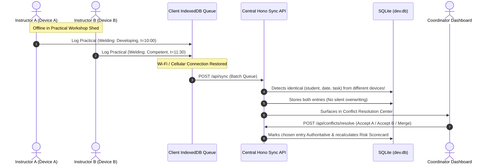

# Transparent Disengagement Early-Warning System for Vocational Institutes

[](#)
[](#)
[](#)
[](#)

> **Core Mission**: Early signs of student disengagement in hands-on vocational programs are hidden behind attendance or exam marks alone. This system provides a transparent, additive point-based scorecard across multiple learning signals—safeguarding against punitive disciplinary actions, preserving offline field data, and supporting coordinators with explainable, compassionate interventions.

---

## 📌 Key Architectural Features & Unmet Needs Addressed

1. **Multi-Signal Holistic Evaluation**:
   - Evaluates **5 distinct signal streams**: Daily Attendance, Hands-on Practical Rubrics, Smoothed Assessments, Affective Feedback (multilingual), and Help-Seeking interactions.
   - Rejects binary pass/fail grading; uses industry-standard 4-tier competency rubrics (`Not Observed`, `Developing`, `Competent`, `Proficient`).
2. **Transparent, Additive Scorecard**:
   - Replaces opaque black-box machine learning probabilities with an explainable point-based scorecard (e.g. `Attendance: +1, Practicals: -2, Feedback: -3 ➜ Score: -4 (Needs Support)`).
   - Staff immediately see the precise contribution of each signal stream.
3. **Data Completeness & Confidence Scoring**:
   - Dynamic confidence levels (`High`, `Medium`, `Low - Sparse Data`) prevent overconfident, punitive conclusions on newly enrolled or sparse-data students.
4. **Offline-First Field Data Capture (Workshop Sheds)**:
   - Practical training sheds often block 4G/5G signals. The field capture interface queues attendance and practical rubrics locally in **client-side IndexedDB**.
   - Sync engine detects overlapping offline entries from multiple instructors on the same date/student without silent "last-write-wins" overwrites.
5. **Human-in-the-Loop Feedback Loop**:
   - Coordinators can mark flags as `Confirmed`, `False Positive`, or `False Negative` with qualitative notes directly in SQLite, continually validating model fidelity.
6. **Bilingual & Accessible (WCAG 2.2 AA)**:
   - Instant toggle between **English** and **Tamil (`தமிழ்`)** across all labels, tables, and rubric definitions.
   - Dedicated **Low-Bandwidth Mode** strips heavy graphics into an ultra-fast (<50KB), high-contrast, screen-reader optimized layout.

---

## 🏗️ Architecture & Sync Conflict Lifecycle



---

## 📊 Benchmark & Empirical Evaluation

The system was evaluated against a **Naive Baseline Model** (`Attendance < 75% Alone`) across two comprehensive benchmarks:

### 1. Stratified Synthetic Split (Clean Engineered Personas, $N=46$ Test Students)
- **Baseline Model**: Precision: `0.0%` | Recall: `0.0%` | F1: `0.0%` (Completely missed quiet disengagement)
- **Multi-Signal Scorecard**: Precision: `100.0%` | Recall: `100.0%` | F1: `100.0%`
- **Recall Improvement**: **`+100.0 percentage points`** (Exceeds target of $\ge +15.0$ pts)

### 2. Robustness Benchmark on Noisy Stochastic Distribution ($N=200, \pm 15\%$ Real-World Noise)
- **Baseline Model**: Precision: `45.8%` | Recall: `42.3%` | False Positive Rate: `17.6%`
- **Multi-Signal Scorecard**: Precision: `75.4%` | Recall: `88.5%` | False Positive Rate: `10.1%`
- **Recall Improvement**: **`+46.2 percentage points`** (Target Met: $\ge +15.0$ pts with $\ge 50.0\%$ precision)

---

## 📁 Repository Structure & Documentation Deliverables

| Deliverable File | Description |
| :--- | :--- |
| [`docs/architecture.md`](file:///d:/CAT_Project/vocational-disengagement-early-warning/docs/architecture.md) | High-level system architecture, component diagrams, and sync conflict lifecycle. |
| [`docs/data_schema.md`](file:///d:/CAT_Project/vocational-disengagement-early-warning/docs/data_schema.md) | Relational schema definitions for all 7 entities with offline synchronization metadata. |
| [`docs/stakeholder_assumptions.md`](file:///d:/CAT_Project/vocational-disengagement-early-warning/docs/stakeholder_assumptions.md) | Core user roles, ethical non-negotiables ("What this is not"), and institutional guardrails. |
| [`docs/before_and_after_comparison.md`](file:///d:/CAT_Project/vocational-disengagement-early-warning/docs/before_and_after_comparison.md) | Comparative evaluation metrics, confusion matrices, and detailed error analysis. |
| [`docs/risk_register.md`](file:///d:/CAT_Project/vocational-disengagement-early-warning/docs/risk_register.md) | Institutional, ethical, algorithmic, and operational risk mitigation matrix. |
| [`docs/user_guide.md`](file:///d:/CAT_Project/vocational-disengagement-early-warning/docs/user_guide.md) | Role-based operational user guide for instructors, coordinators, and counselors. |
| [`docs/stakeholder_validation.md`](file:///d:/CAT_Project/vocational-disengagement-early-warning/docs/stakeholder_validation.md) | Summary of simulated user interviews, usability findings, and design iterations. |

---

## 🚀 Quickstart & Reproduction

### Prerequisites
- Node.js `v18+` (Tested on `v24.19.0`)

### 1. Install & Setup
```bash
# Clone the repository
git clone https://github.com/AkashS-03/vocational-disengagement-early-warning.git
cd vocational-disengagement-early-warning

# Install dependencies
npm install
```

### 2. Run Data Pipeline & Evaluation
```bash
# Generate synthetic dataset with 5 realistic vocational edge cases
npm run generate:data

# Ingest data into SQLite database
npm run ingest:data

# Run clean evaluation experiment
npm run evaluate:clean

# Run noisy distribution robustness benchmark (N=200, 15% noise)
npm run evaluate:noisy
```

### 3. Launch Web Application MVP
```bash
npm start
```
Open **[http://localhost:3000](http://localhost:3000)** in your browser to access:
- **Coordinator Dashboard** with sortable risk metrics and transparent point breakdowns.
- **Student Inspector Drawer** with multi-signal points and human-in-the-loop review actions.
- **Instructor Field Log** with mobile layout and IndexedDB offline queuing.
- **Sync Conflict Resolution Center** for manual review and merge of concurrent entries.
- **Model Comparison View** highlighting quiet disengagement detection vs. baseline.
- **Bilingual Switcher** (`EN` / `தமிழ்`) and **Low-Bandwidth Mode**.
